# PageRank Performance Evaluation

## 1. Purpose

This report compares the sequential PageRank implementation with its OpenMP counterpart on two cleaned LiveJournal prefix samples. It evaluates solver runtime, speedup, thread efficiency, memory usage, and observed scalability.

All numerical results come from completed benchmark runs. No missing values are estimated or presented as measurements.

## 2. Experimental environment

| Property | Value |
|---|---|
| Operating system | Ubuntu 24.04.5 LTS on WSL2 |
| Kernel | Linux 6.18.54.1-microsoft-standard-WSL2 |
| CPU | 11th Gen Intel Core i5-1135G7 @ 2.40 GHz |
| Physical cores | 4 |
| Logical processors | 8 |
| SMT | Enabled |
| Available memory during runs | Approximately 3.19 GiB |
| Compiler | g++ 13.3.0 |
| Compiler flags | `-std=c++17 -O3 -fopenmp` |
| Python | 3.12.3 |
| OpenMP placement | `OMP_PLACES=cores`, `OMP_PROC_BIND=close` |

Available memory is the observed system value recorded by the benchmark runner, not a guaranteed memory limit.

## 3. Datasets

Both inputs are prefixes of the cleaned LiveJournal edge ordering, not random samples.

| Dataset | File size (bytes) | Observed nodes | Directed edges | Type |
|---|---:|---:|---:|---|
| 100 MiB | 104,857,589 | 4,847,571 | 8,015,157 | Prefix sample |
| 500 MiB | 524,287,992 | 4,847,571 | 37,672,977 | Prefix sample |
| Full graph (reference only) | — | 4,847,571 | 68,993,773 | Not benchmarked |

The observed node count is the maximum vertex ID plus one. The samples preserve the original edge ordering and should not be assumed to represent random or structurally representative samples of the full graph.

## 4. Methodology

The benchmark used:

- Damping factor: `0.85`
- Convergence tolerance: `1e-6`
- Maximum iterations: `100`
- Initial rank: `1/N`
- Dangling-node rank: redistributed equally
- Directed edge orientation: preserved
- OpenMP configurations: 1, 2, 4, and 8 requested threads

Each configuration received one unmeasured warm-up. The 100 MiB experiment used five measured repetitions per configuration; the 500 MiB experiment used three. Medians are reported as the primary runtime statistic. Minimum, maximum, and sample coefficient of variation (CV) are also included.

The runner checked convergence, rank sums, top-10 rankings, and numerical differences against a sequential reference. All measured configurations completed successfully and passed the recorded correctness checks.

Solver runtime is measured separately from graph loading. It excludes parsing and compilation. Process peak RSS includes graph loading and, for OpenMP trials, the sequential correctness-reference work; it is not solver-only memory usage.

## 5. Runtime results

### 5.1 100 MiB experiment

Run ID: `20261116T202720Z`

| Configuration | Successful repetitions | Median (s) | Min (s) | Max (s) | CV | Unstable (CV > 0.1) | Median peak RSS (KiB) |
|---|---:|---:|---:|---:|---:|---|---:|
| Sequential | 5/5 | 2.88515 | 2.70789 | 3.42865 | 0.10633 | Yes | 211,544 |
| OpenMP 1 thread | 5/5 | 3.15033 | 2.62146 | 3.58697 | 0.12892 | Yes | 281,528 |
| OpenMP 2 threads | 5/5 | 3.44494 | 2.90358 | 3.97201 | 0.12067 | Yes | 281,476 |
| OpenMP 4 threads | 5/5 | 2.83951 | 2.74597 | 3.06567 | 0.04377 | No | 281,480 |
| OpenMP 8 threads | 5/5 | 3.10713 | 2.24158 | 3.73957 | 0.18626 | Yes | 281,560 |

The four-thread configuration was marginally faster than sequential execution, with a speedup of approximately 1.016×. This is a small improvement, and the variability in several configurations means it should not be interpreted as strong evidence of scaling.

### 5.2 500 MiB experiment

Run ID: `20261116T203814Z`

| Configuration | Successful repetitions | Median (s) | Min (s) | Max (s) | CV | Unstable (CV > 0.1) | Median peak RSS (KiB) |
|---|---:|---:|---:|---:|---:|---|---:|
| Sequential | 3/3 | 16.49924 | 16.36808 | 20.45359 | 0.13063 | Yes | 559,200 |
| OpenMP 1 thread | 3/3 | 18.58923 | 17.96022 | 20.98892 | 0.08333 | No | 559,184 |
| OpenMP 2 threads | 3/3 | 18.83251 | 17.39808 | 19.26945 | 0.05292 | No | 559,236 |
| OpenMP 4 threads | 3/3 | 14.39185 | 14.24411 | 15.14499 | 0.03311 | No | 559,168 |
| OpenMP 8 threads | 3/3 | 12.02238 | 11.06692 | 14.08865 | 0.12463 | Yes | 559,184 |

The eight-thread configuration achieved the best observed runtime on this sample. Its median was approximately 27% lower than the sequential median. However, its CV exceeded 0.1, so the result should be treated as an observed improvement rather than a statistically conclusive scaling result.

## 6. Speedup and efficiency

Sequential speedup is calculated as:

`T_seq / T_omp(P)`

OpenMP self-relative speedup is:

`T_omp(1) / T_omp(P)`

Efficiency is:

`Sequential speedup / P`

### 6.1 100 MiB

| Threads | Sequential speedup | OpenMP self-speedup | Efficiency |
|---:|---:|---:|---:|
| 1 | 0.91583 | 1.00000 | 0.91583 |
| 2 | 0.83751 | 0.91448 | 0.41875 |
| 4 | 1.01607 | 1.10946 | 0.25402 |
| 8 | 0.92856 | 1.01390 | 0.11607 |

### 6.2 500 MiB

| Threads | Sequential speedup | OpenMP self-speedup | Efficiency |
|---:|---:|---:|---:|
| 1 | 0.88757 | 1.00000 | 0.88757 |
| 2 | 0.87610 | 0.98708 | 0.43805 |
| 4 | 1.14643 | 1.29165 | 0.28661 |
| 8 | 1.37238 | 1.54622 | 0.17155 |

Efficiency decreases as thread count increases. The eight-thread configuration has the highest observed speedup on the larger sample, but its efficiency is substantially below ideal linear scaling.

## 7. Amdahl's and Gustafson's laws

The effective Karp–Flatt serial fraction is estimated from the two-thread sequential speedup.

| Dataset | P=2 Karp–Flatt estimate | Status | Amdahl projections | Gustafson illustration |
|---|---:|---|---|---|
| 100 MiB | 1.38804 | Out of range | Unavailable | Unavailable |
| 500 MiB | 1.28283 | Out of range | Unavailable | Unavailable |

Both estimates exceed the valid interval [0, 1]. Consequently, they are not suitable for Amdahl projections or Gustafson illustrations. This can occur when the measured parallel implementation is slower than the sequential baseline at the calibration point.

No serial fraction or theoretical projection is fabricated to fill these unavailable values. Amdahl's and Gustafson's laws remain useful theoretical models, but these measurements do not provide a valid calibration for them.

## 8. Scalability and interpretation

The results show different behavior across the two input sizes:

- On the 100 MiB sample, OpenMP provided no substantial improvement. Four threads were only marginally faster than sequential execution.
- On the 500 MiB sample, four threads achieved approximately 1.146× speedup, while eight threads achieved approximately 1.372×.
- One and two OpenMP threads were slower than the sequential implementation on both samples.
- Efficiency decreased with increasing thread count, demonstrating that scaling was not linear.
- The CPU has four physical cores and eight logical processors. SMT, memory bandwidth, synchronization, scheduling overhead, and workload characteristics may contribute to the observed scaling behavior.

These results suggest that the larger sample benefits more from parallel execution, but the measurements do not establish that the same speedup will occur on the full graph.

## 9. Figures

### 9.1 100 MiB sample

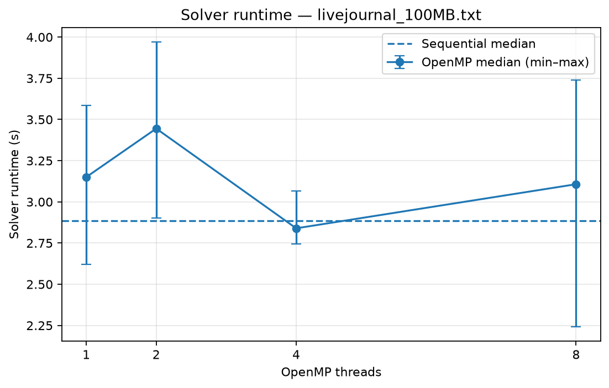

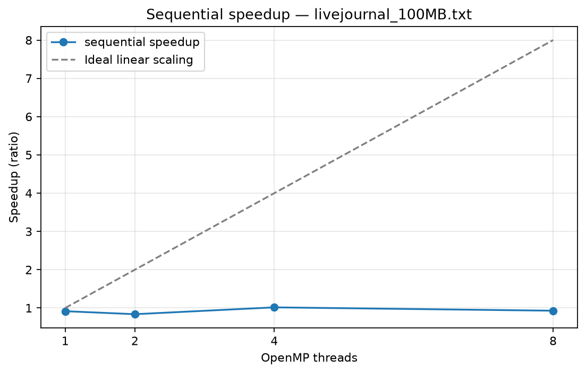

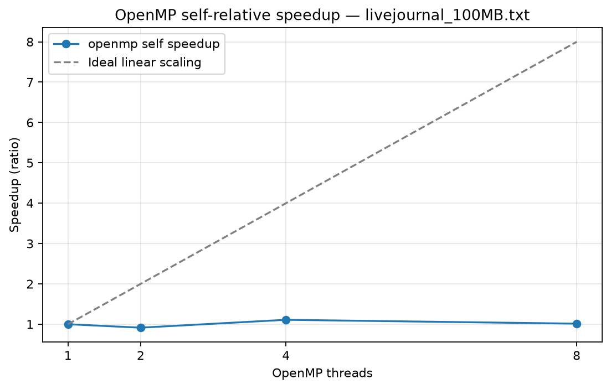

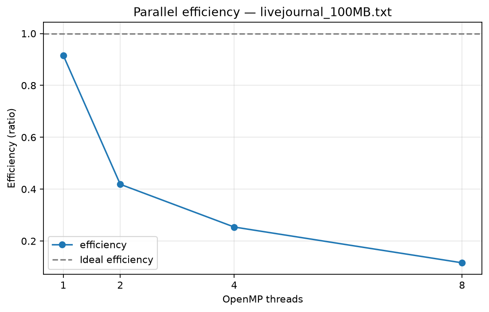

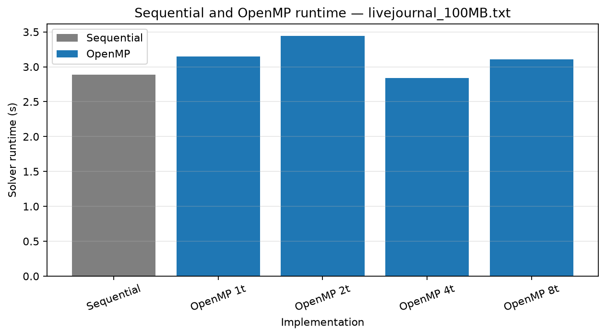

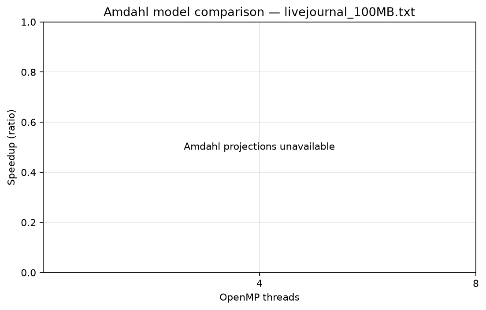

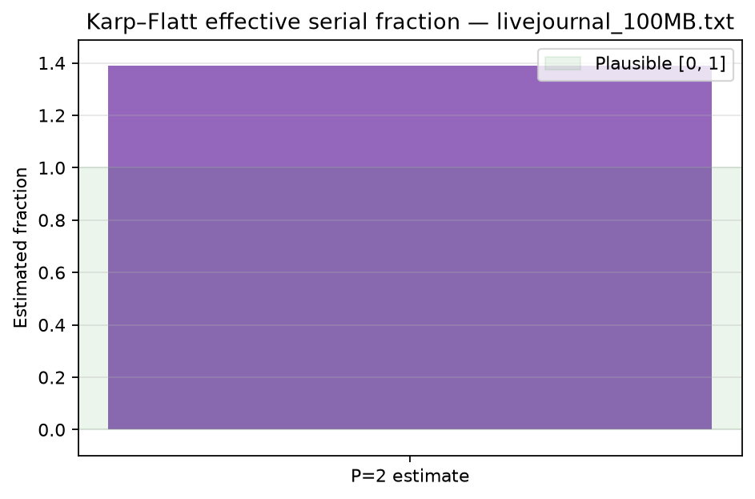

### 9.2 500 MiB sample

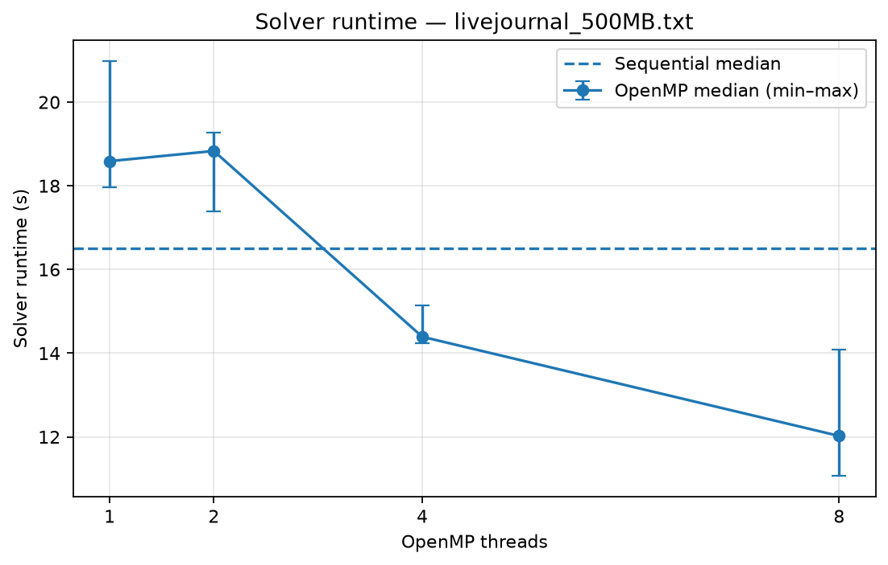

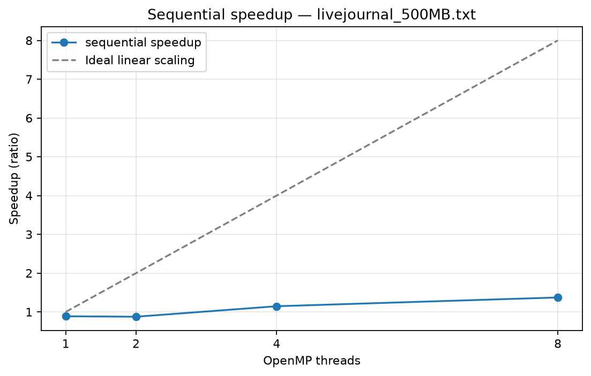

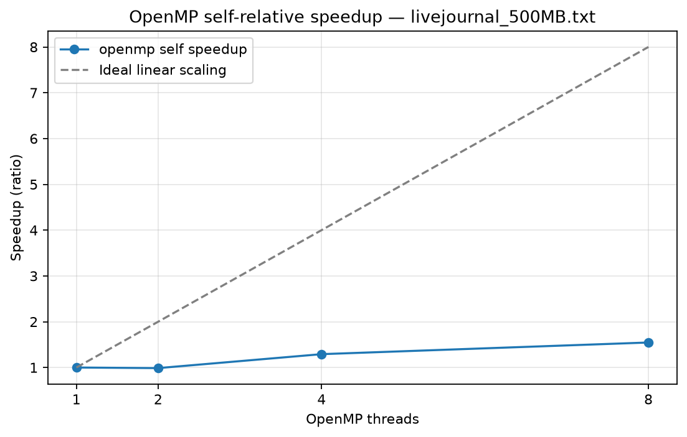

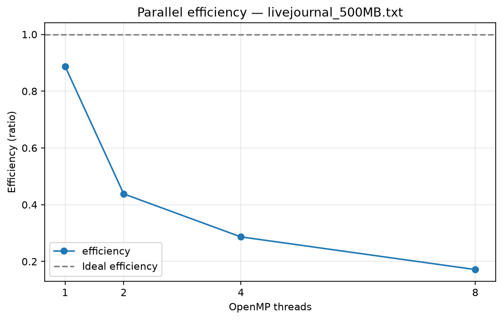

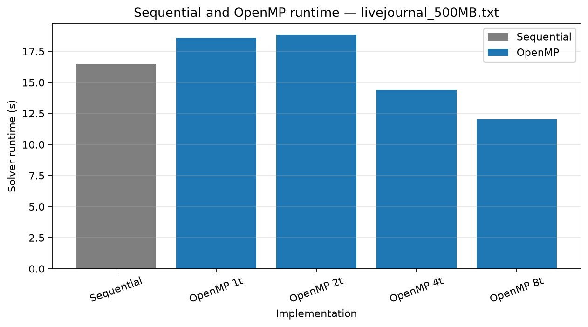

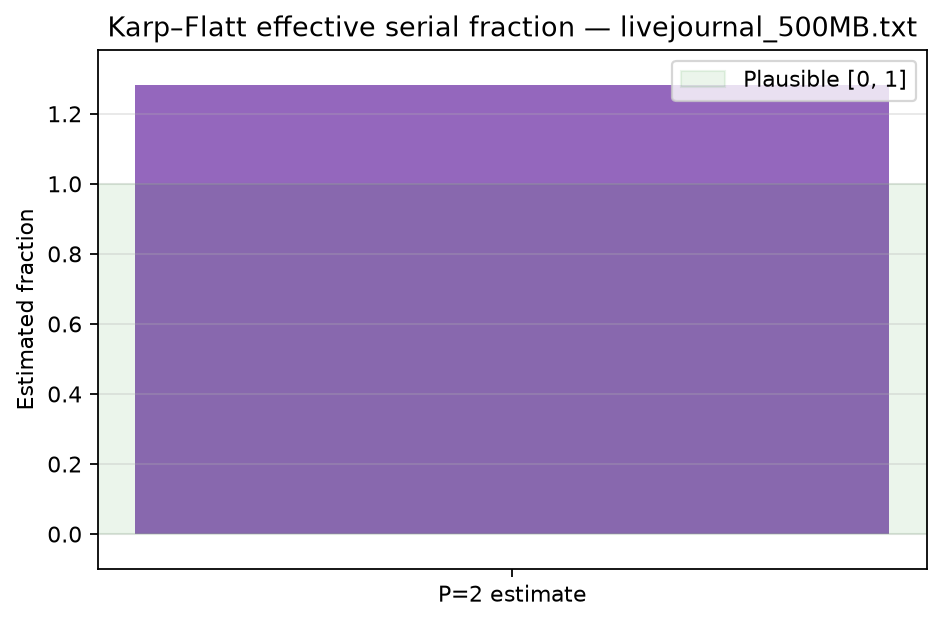

## 10. Limitations

- The full 68,993,773-edge graph was not benchmarked. Only the 100 MiB and 500 MiB prefix samples were measured.
- Prefix samples preserve the original edge ordering and are not random samples.
- The 500 MiB experiment used three measured repetitions per configuration, while the 100 MiB experiment used five.
- Timing variability, CPU frequency scaling, background processes, cache state, WSL resource constraints, and SMT can affect results.
- Solver-only runtime excludes graph loading and therefore does not represent complete application execution time.
- Peak RSS includes graph loading and correctness-reference work.
- The Karp–Flatt estimates are outside the valid range, preventing meaningful Amdahl and Gustafson projections from these measurements.
- The CLI/API defaults of the sequential and OpenMP implementations remain `1e-8`; the benchmark explicitly supplied the required `1e-6` tolerance.

## 11. Conclusion

The completed experiments demonstrate that OpenMP performance depends on input size and thread count.

The 100 MiB sample showed little benefit from parallelization, with only a marginal improvement at four threads. The 500 MiB sample showed better parallel performance: four threads achieved approximately 1.146× speedup and eight threads achieved approximately 1.372× speedup over the sequential implementation.

However, scaling was not linear, efficiency decreased as thread count increased, and the eight-thread result on the larger sample showed noticeable variability. The results therefore support a cautious conclusion: OpenMP improved observed runtime on the larger tested sample, but the available experiments do not establish full-graph performance or statistically robust scaling.

## 12. Reproduction and raw evidence

See [benchmarks/README.md](../benchmarks/README.md) for benchmark build and execution instructions.

The completed experiment artifacts are stored in:

- `results/performance/20261116T202720Z/` — 100 MiB run, including raw trials, summary, metadata, logs, and generated report.
- `results/performance/20261116T203814Z/` — 500 MiB run, including raw trials, summary, metadata, logs, and generated report.
- `plots/performance/20261116T202720Z/` — 100 MiB figures.
- `plots/performance/20261116T203814Z/` — 500 MiB figures.

The input datasets themselves are not included in Git.
