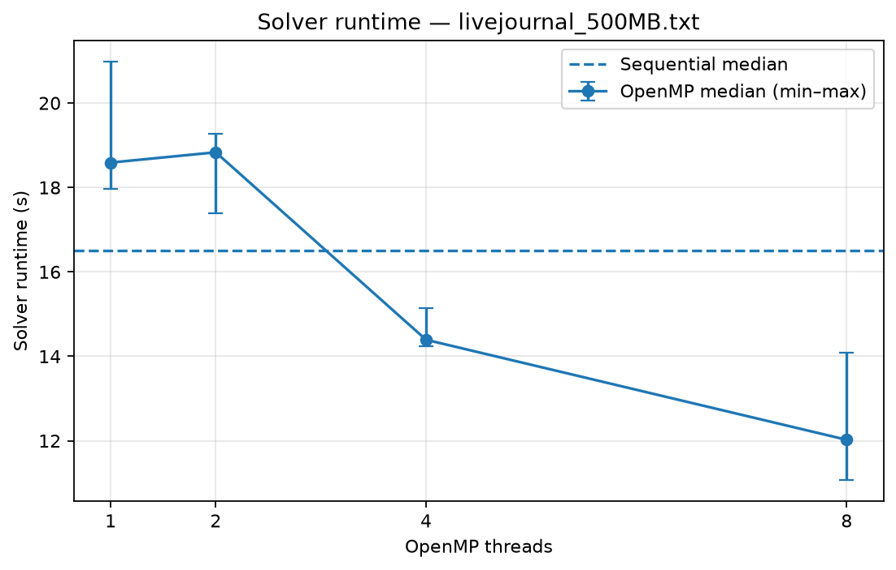
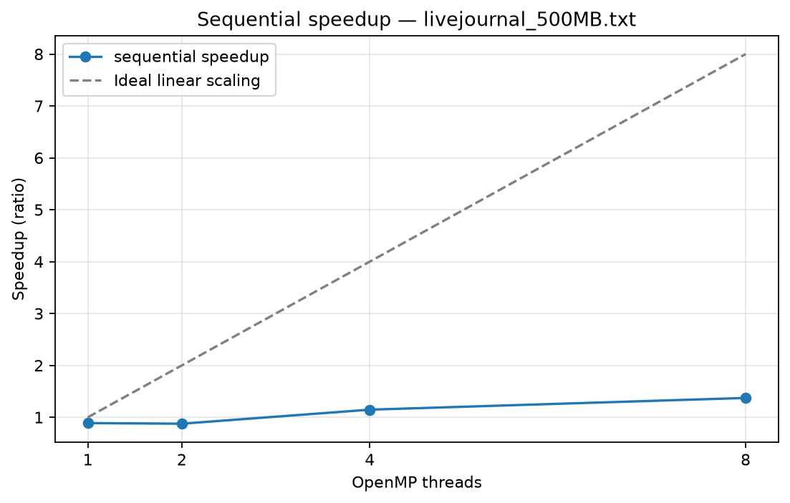
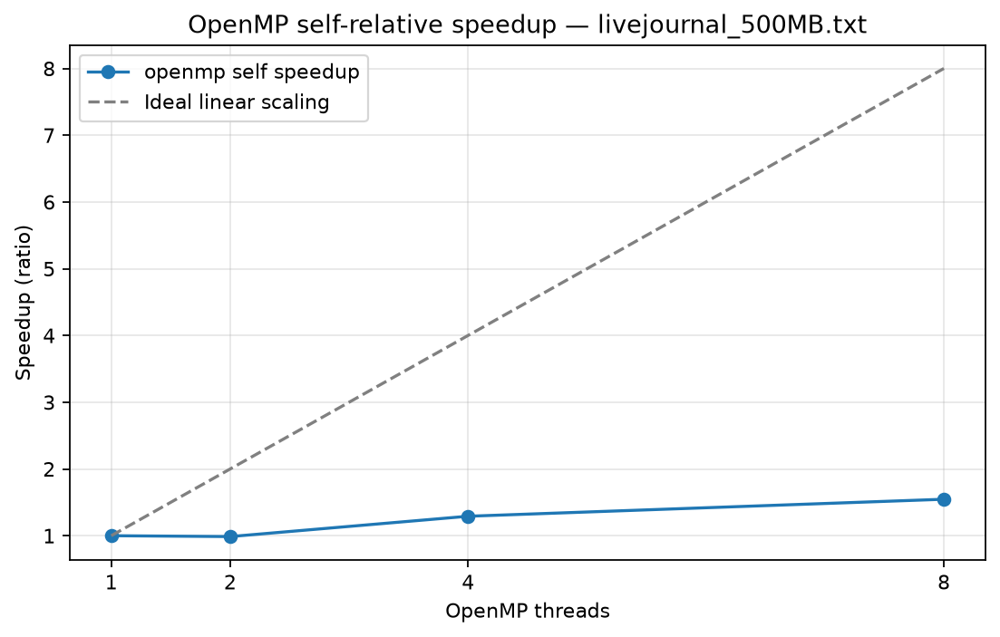
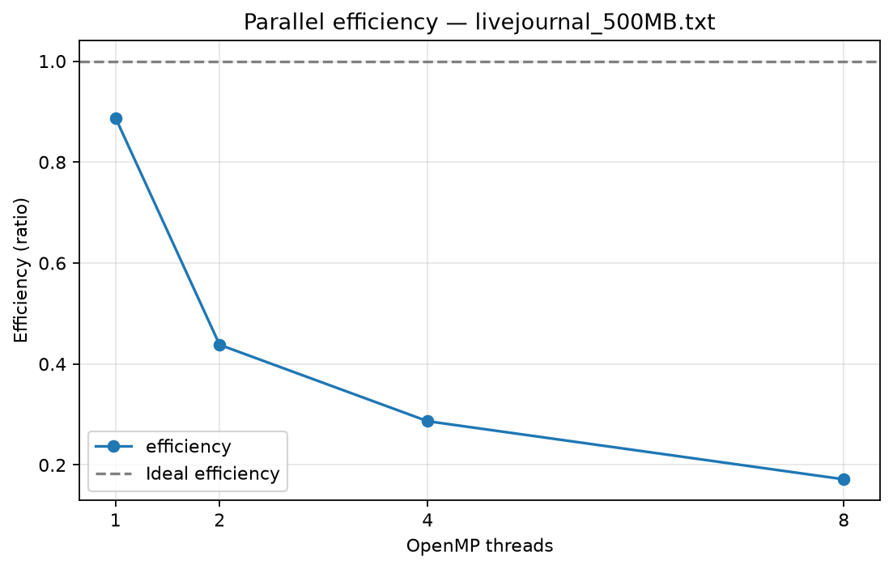
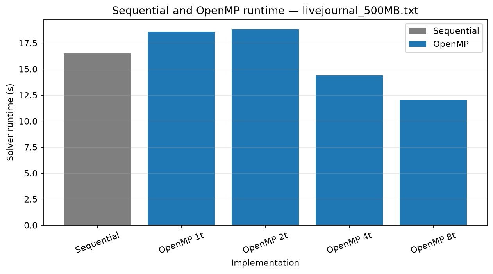
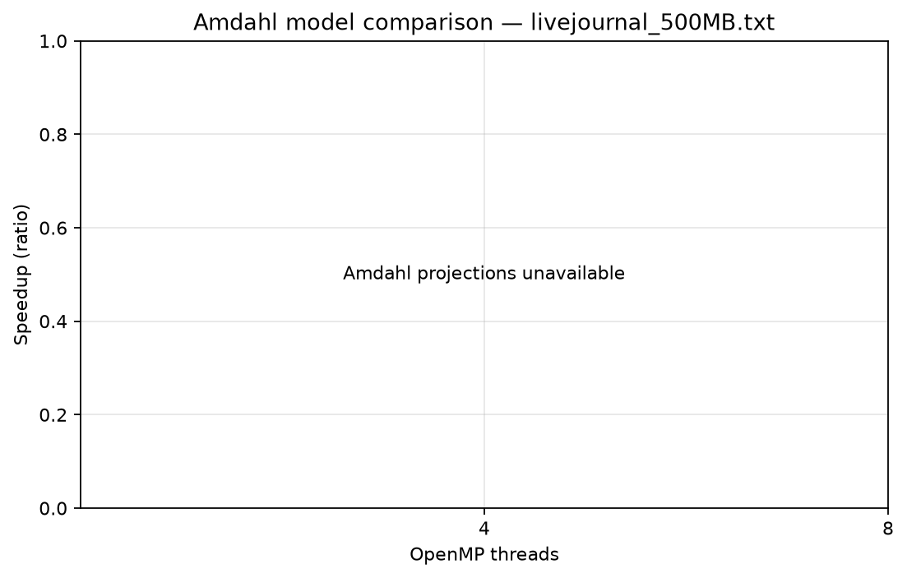
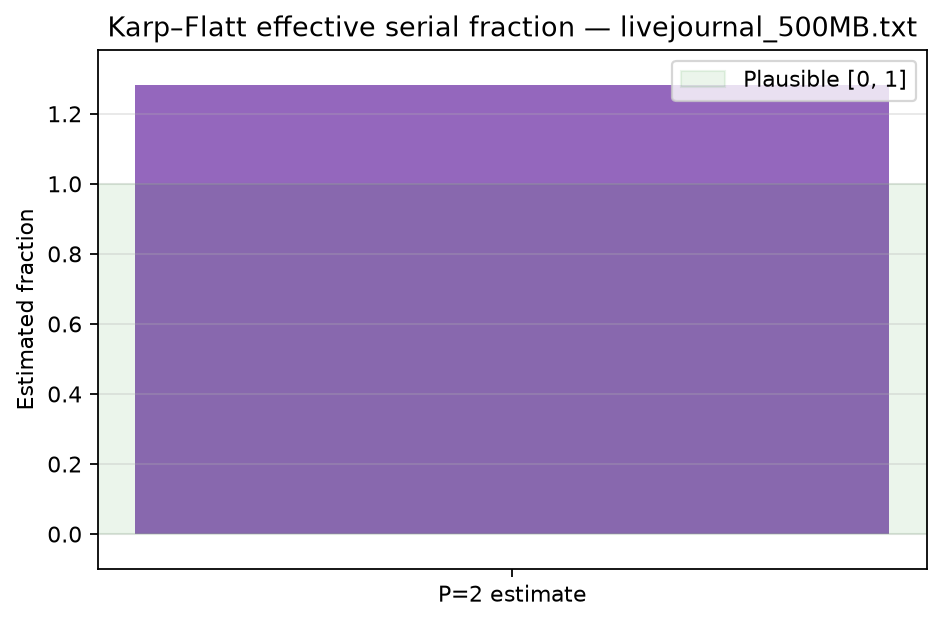

# PageRank Performance Evaluation

**Run:** `20261116T203814Z` 
**Experiment status:** `completed` 
**Report category:** LiveJournal experiment or incomplete experiment

## Purpose and methodology

Compare sequential PageRank against OpenMP at 1, 2, 4, and 8 requested threads. Solver runtime is timed with `steady_clock`; graph loading is timed separately, and process wall time includes graph loading plus any correctness-reference work. `average_iteration_seconds_derived` is solver time divided by iterations, not direct per-iteration instrumentation. Compilation is excluded.

Parameters: damping `0.85`, tolerance `1e-06`, maximum iterations `100`, warm-ups `1`, measured repetitions `3`, comparison tolerance `1e-06`. The tolerance is the required default.

Warm-ups are excluded from statistics. Configuration order is reproducibly interleaved by random seed to reduce systematic thermal/frequency bias. Medians are primary; min/max and sample coefficient of variation identify variability. Five measured repetitions are recommended for final 100/500 MiB experiments.

Convergence requires final L1 error below the supplied tolerance before the iteration limit. Rank sums are checked against 1.0. Each OpenMP process also computes a sequential reference on the same loaded graph and reports maximum absolute rank difference, top-10 rankings, convergence statuses, and iteration counts. Iteration-count differences are recorded but are not alone deemed incorrect. Comparison tolerance is explicit in the run metadata.

## Experimental environment

| Property | Value |
|---|---|
| OS / kernel | Linux-6.18.54.1-microsoft-standard-WSL2-x86_64-with-glibc2.39 / 6.18.54.1-microsoft-standard-WSL2 |
| Linux distribution | Ubuntu 24.04.5 LTS |
| WSL detected / version | True / WSL version: 3.0.3.0 Kernel version: 6.18.54.1-1 WSLg version: 1.0.79 MSRDC version: 1.2.7391 Direct3D version: 1.611.1-81528511 DXCore version: 10.0.26100.1-240331-1435.ge-release Windows version: 10.0.26200.9457 |
| CPU | 11th Gen Intel(R) Core(TM) i5-1135G7 @ 2.40GHz |
| Physical cores / logical processors | 4 / 8 |
| SMT status | enabled or logical count exceeds physical core count |
| Available system memory | 3.193 GiB |
| Compiler | g++ (Ubuntu 13.3.0-6ubuntu2~24.04.1) 13.3.0 |
| Python | 3.12.3 |
| CPU governor | unavailable |
| WSL memory configuration | unavailable |
| Git branch / commit / dirty | member3-benchmarking / `364896bea68295bcade798a797098b84450902c4` / True |
| Effective OpenMP environment | `{"OMP_DYNAMIC": "FALSE", "OMP_NUM_THREADS": "per-run requested team size", "OMP_PLACES": "cores", "OMP_PROC_BIND": "close"}` |

Peak RSS is measured per harness process via Linux `getrusage(RUSAGE_SELF)` and reported in KiB. It is the process high-water mark including graph loading and, for OpenMP trials, the sequential correctness check; it is not system-wide memory or solver-only memory. `unavailable` is reported on unsupported platforms.

## Dataset validation

| Dataset | Type | State | Size (bytes) | Observed nodes | Directed edges | Validation | SHA-256 |
|---|---|---|---:|---:|---:|---|---|
| livejournal_500MB.txt | prefix_sample | available | 524287992 | 4847571 | 37672977 | matches_documented_counts | `0ffc2842637305c8f179e5ac4a663f2e09578f563747b2ffc6c3819c002c2adc` |
- **livejournal_500MB.txt:** Prefix of original edge ordering; observed node count is max ID plus one, not assumed to be the full-graph count.
- **livejournal_500MB.txt:** Observed node count is 4,847,571 (max vertex ID + 1 in this graph), not assumed full-graph node count.

The documentation gives 8,015,157 and 37,672,977 edges for the 100 and 500 MiB prefixes, and 4,847,571 nodes / 68,993,773 directed edges for the full graph. Prefix node count is the observed maximum vertex ID plus one and is not assumed to equal the full graph node count. The loader stores incoming adjacency while retaining directed edge orientation; observed edge count is checked against the number of records loaded. Prefix sizes/order may alter graph structure and are not random samples.

## Configuration results

| Dataset | Impl. | Threads | Successful / required | Status | Median solver (s) | Min (s) | Max (s) | CV (ratio) | Unstable (CV > 0.1) | Median peak RSS (KiB) | Convergence / correctness |
|---|---|---:|---:|---|---:|---:|---:|---:|---|---:|---|
| livejournal_500MB.txt | sequential | 1 | 3 / 3 | complete | 16.4992 | 16.3681 | 20.4536 | 0.130634 | True | 559200 | complete |
| livejournal_500MB.txt | openmp | 1 | 3 / 3 | complete | 18.5892 | 17.9602 | 20.9889 | 0.0833335 | False | 559184 | complete |
| livejournal_500MB.txt | openmp | 2 | 3 / 3 | complete | 18.8325 | 17.3981 | 19.2694 | 0.0529185 | False | 559236 | complete |
| livejournal_500MB.txt | openmp | 4 | 3 / 3 | complete | 14.3918 | 14.2441 | 15.145 | 0.0331073 | False | 559168 | complete |
| livejournal_500MB.txt | openmp | 8 | 3 / 3 | complete | 12.0224 | 11.0669 | 14.0886 | 0.124632 | True | 559184 | complete |

Per-run convergence, final error, iterations, rank sum, deterministic top-10, requested/actual threads, numerical difference, process wall time, graph-load time, and peak RSS are recorded in `raw_runs.csv`. Non-converged, failed, timed-out, memory-aborted, and not-started configurations remain visible in raw and summary outputs.

## Performance metrics

Sequential speedup is `T_seq / T_omp(P)`. OpenMP self-relative speedup is `T_omp(1) / T_omp(P)`. Efficiency is sequential speedup divided by P. Values are calculated only from complete successful medians. A serial fraction is estimated from P=2 only. Amdahl predictions at P=4 and P=8 use that P=2 estimate, so the calibration point is not repeated as purported independent prediction. Values outside [0,1] are flagged and not used for projections. Gustafson values are illustrative theory; fixed-size runs do not validate scaled speedup. A solver-only serial fraction need not describe the end-to-end application.

| Dataset | Threads | Sequential speedup | OpenMP self-speedup | Efficiency | Karp–Flatt s (from P=2) | Amdahl prediction from P=2 | Measured − predicted | Gustafson illustration | Estimate status |
|---|---:|---:|---:|---:|---:|---:|---:|---:|---|
| livejournal_500MB.txt | 1 | 0.88757 | 1 | 0.88757 | 1.28283 | Unavailable | Unavailable | Unavailable | out_of_range |
| livejournal_500MB.txt | 2 | 0.876104 | 0.987082 | 0.438052 | 1.28283 | Unavailable | Unavailable | Unavailable | out_of_range |
| livejournal_500MB.txt | 4 | 1.14643 | 1.29165 | 0.286607 | 1.28283 | Unavailable | Unavailable | Unavailable | out_of_range |
| livejournal_500MB.txt | 8 | 1.37238 | 1.54622 | 0.171547 | 1.28283 | Unavailable | Unavailable | Unavailable | out_of_range |

## Figures

Plots include min–max runtime ranges, sequential and OpenMP self-relative speedup (with ideal linear references), efficiency, comparison bars, P=2 Karp–Flatt estimate, and Amdahl projections versus measured P=4/P=8 speedup. Failed configurations are labeled rather than silently omitted.

## Limitations and interpretation

- Sequential and OpenMP CLI/API defaults are currently `1e-8`; the benchmark explicitly supplies the project-required `1e-6` unless overridden. Teammate source files were not changed.
- The benchmark times solver calls, excluding edge-list parsing; process wall includes graph load and correctness-reference work.
- OpenMP's static contiguous node partition can have load imbalance for skewed in-degree distributions; no scheduling implementation was changed.
- Frequency scaling, cache state, system load, WSL resource limits, and SMT can influence observed timing.
- Full LiveJournal data is memory intensive. Guard estimates are heuristics, not measured RSS.
- Amdahl and Gustafson are models, not measured speedup; Gustafson scaled behavior is not tested.

Full raw data, environment, manifest, and build logs are in `/mnt/d/Y4S1/Parallel and Distributed Computing/Project/Parallel Project/results/performance/20261116T203814Z`. No dataset, missing result, or tiny-fixture timing should be presented as a completed LiveJournal experiment.
